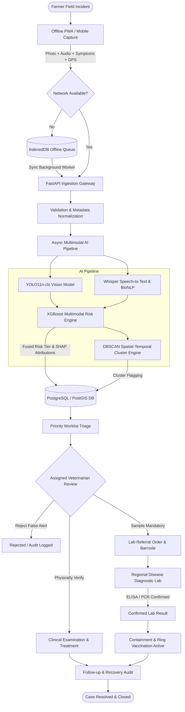
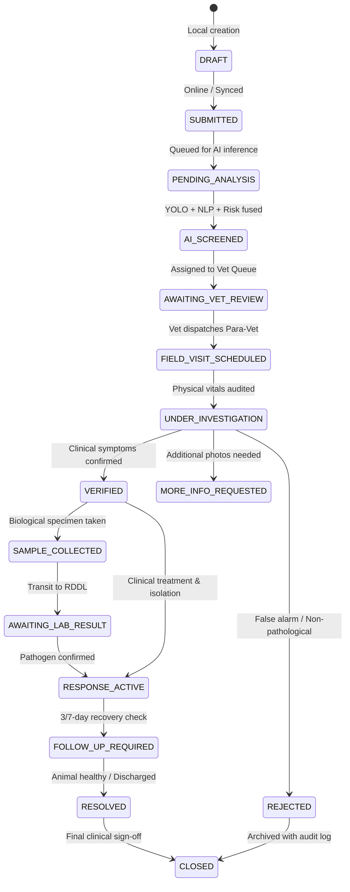
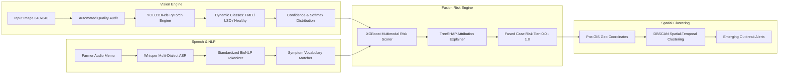
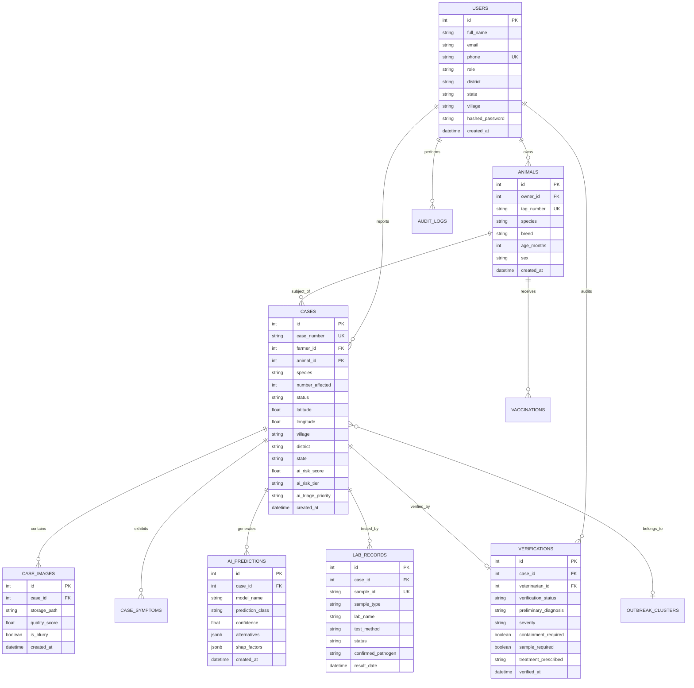
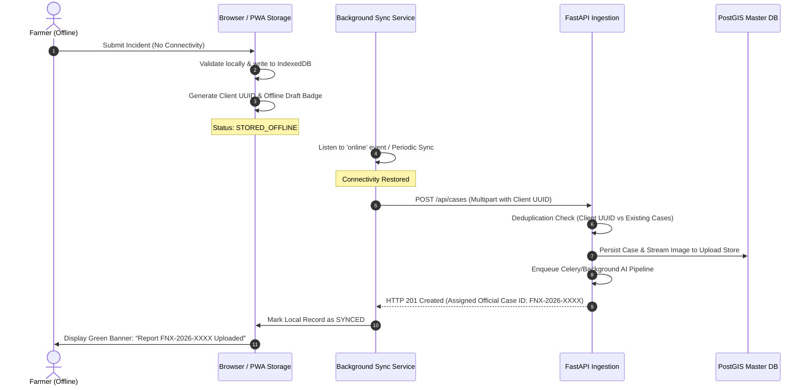

# FAUNA-X: Product Requirements Document (PRD) & Technical Feature Specification

> **AI-Powered Livestock Health Intelligence & Early Outbreak Response System**  
> *Smart India Hackathon 2026 — Problem Statement SIH26128*  
> **Target Authority**: Department of Animal Husbandry and Dairying (DAHD), State Animal Health Directorates, Field Veterinary Services, and Livestock Farmers.

---

## 1. Product Requirements Document (PRD)

### 1.1 Problem Statement & Background
Livestock diseases such as Foot-and-Mouth Disease (FMD), Lumpy Skin Disease (LSD), Brucellosis, and Peste des Petits Ruminants (PPR) inflict catastrophic economic losses on Indian rural smallholder households, milk unions, and national agricultural GDP. Current surveillance mechanisms suffer from:
1. **Reporting Latency**: Farmers often wait days to report morbidities or resort to unverified local remedies.
2. **Geographic Gaps**: Rural field veterinary dispensaries are understaffed, with poor rural broadband connectivity preventing timely case logging.
3. **Fragmented Data**: Syndromic field observations, laboratory diagnostics, and macro-epidemiological containment actions exist in isolated operational silos.
4. **Lack of Automated Early Warning**: Regional outbreaks are detected only after large-scale secondary transmission has occurred.

### 1.2 Product Vision & Objectives
**FAUNA-X** is an end-to-end, multi-tier livestock disease surveillance and syndromic early response platform. It establishes a closed-loop governance pipeline:

$$\text{Farmer Field Signal} \xrightarrow{} \text{Edge AI Visual/Voice Triage} \xrightarrow{} \text{Spatial-Temporal Clustering} \xrightarrow{} \text{Veterinary Audit} \xrightarrow{} \text{Containment & Lab Referral} \xrightarrow{} \text{State/National Macro Surveillance}$$

### 1.3 Target Personas
1. **Rural Livestock Farmer**: Needs extreme simplicity, offline queuing, voice/local-language support, and clear, panic-free veterinary advisories.
2. **Field Veterinary Officer / Para-Vet**: Needs quick offline digital investigation forms, case GPS verification, sample collection tracking, and clear clinical priority worklists.
3. **Veterinary Clinical Specialist**: Needs high-fidelity image inspection, AI confidence metrics with SHAP explainability, differential diagnosis audit tools, and lab referral workflows.
4. **District Animal Husbandry Officer (AHO)**: Needs spatial cluster alerts (DBSCAN), veterinary workload balancing, vaccination coverage audits, and containment dispatch controls.
5. **State Director of Animal Health**: Needs district performance benchmarks, inter-district movement alerts, vaccine stock allocation, and policy containment directives.
6. **National Surveillance Authority (DAHD)**: Needs aggregated cross-state epidemiological heatmaps, international reporting compliance (WOAH/OIE), and macro supply chain planning.

---

## 2. User Role & Permission Matrix

| Functional Capability | Farmer | Para-Vet / Field Officer | Veterinarian | District Admin | State Admin | National Admin |
| :--- | :---: | :---: | :---: | :---: | :---: | :---: |
| **Self-Registration & OTP Login** | ✅ | ✅ | ✅ | 🔒 (Admin Invite) | 🔒 (Govt Assigned) | 🔒 (Govt Assigned) |
| **Herd & Animal ID Registry** | ✅ (Own) | ✅ (Assigned Village) | ✅ (Clinical Cases) | 👁️ (Aggregated) | 👁️ (Aggregated) | 👁️ (Aggregated) |
| **Submit Incident with Image/Voice**| ✅ | ✅ | ✅ | ❌ | ❌ | ❌ |
| **Offline Form & Queue Sync** | ✅ | ✅ | ✅ | ❌ | ❌ | ❌ |
| **View Raw Model Metrics & SHAP** | ❌ | ❌ | ✅ | ✅ | ✅ | ✅ |
| **Official Veterinary Verification** | ❌ | ❌ | ✅ | 👁️ (Audit) | 👁️ (Audit) | 👁️ (Audit) |
| **Order Lab Samples & Tests** | ❌ | ✅ (Collection) | ✅ (Requisition) | 👁️ (Status) | 👁️ (Status) | 👁️ (Status) |
| **Issue Containment / Quarantine** | ❌ | ❌ | ✅ (Local Farm) | ✅ (Block/District) | ✅ (Inter-District) | ✅ (National Policy)|
| **View Spatial Cluster Analytics** | ❌ | 👁️ (Village Buffer) | 👁️ (District Triage) | ✅ (Full Interactive) | ✅ (Full Interactive) | ✅ (Full Interactive)|
| **Export District/State GIS Datasets**| ❌ | ❌ | ❌ | ✅ (District Scoped) | ✅ (State Scoped) | ✅ (National Scoped)|
| **Override / Suppress False Alerts** | ❌ | ❌ | ✅ (Clinical Reject)| ✅ (Cluster Merge) | ✅ (State Review) | ✅ (System Audit) |

*Legend: ✅ = Full Execution; 👁️ = Read-Only / Scoped View; 🔒 = Provisioned Access; ❌ = No Access.*

---

## 3. Feature Inventory by Role

### 3.1 Farmer Interface (Mobile-First / PWA)
- **F-01: Multi-Factor Authentication**: 10-digit mobile number + SMS OTP with automatic offline credential caching.
- **F-02: Animal Herd Ledger**: Registration of individual cattle, buffalo, sheep, goat, swine, poultry with tag IDs, age, breed, and lactation/work status.
- **F-03: Guided 8-Step Symptom Reporting Wizard**:
  - Species and affected count.
  - Image capture (camera autofocus, blur detection, resolution check).
  - Multilingual voice symptom memo with waveform indicator.
  - Interactive anatomical tap-to-select symptom map (mouth, hooves, skin, udder, eyes, respiratory).
  - Temperature, appetite, mobility, duration, and mortality input.
  - GPS autofill with offline fallback to village/taluka dropdowns.
- **F-04: Non-Diagnostic AI Assessment Card**:
  - Plain-language visual indicator summary (e.g., *"Skin nodules detected with high consistency"*).
  - Clear non-diagnostic disclaimer: *"This is an early indicator, not an official veterinary diagnosis."*
  - Immediate farmer action advisory (e.g., *"Isolate affected animal, provide clean drinking water, avoid herd movement"*).
- **F-05: Case Tracking & Vet Status**: Real-time progress bar (Submitted → Triaged → Vet Assigned → Visited → Verified → Resolved).
- **F-06: Local Bio-Advisory Feed**: Push notifications regarding seasonal disease warnings, local vaccination camps, and official quarantine zones within a 15 km radius.
- **F-07: Offline Queue Manager**: Local IndexedDB draft storage with background sync when connectivity is restored.

### 3.2 Field Officer / Para-Veterinary Worker
- **FO-01: Village Assignment Worklist**: Filterable queue of reported incidents assigned by block or panchayat.
- **FO-02: Field Verification & Physical Inspection Module**:
  - GPS geo-fenced check-in at the farm location.
  - Animal vitals validation (rectal temperature, heart rate, lesion inspection).
  - Rapid field test kit recording (e.g., lateral flow strip results).
- **FO-03: Biological Sample Collection Assistant**: Barcode/QR-code scanning of sterile blood, swab, or serum vials; cold-chain tracking; and transit dispatch to assigned diagnostic labs.
- **FO-04: Ring Vaccination Logging**: Bulk barcode scanning of ear-tags during emergency barrier vaccination campaigns.
- **FO-05: Biosecurity & Sanitization Verification**: Checklists for carcass disposal, liming, and disinfectant barriers.

### 3.3 Veterinarian (Clinical & Triage Web/Tablet)
- **V-01: Clinical Triage Worklist**: Priority queue sorted by fused AI risk tier (`CRITICAL`, `HIGH`, `MEDIUM`, `ROUTINE`).
- **V-02: Deep Clinical Case Dossier**:
  - High-resolution raw image viewer with zoom, brightness/contrast adjustments, and quality score.
  - YOLO bounding box / class confidence overlay toggle.
  - Whisper Hindi/regional audio transcript with editable symptom corrections.
  - SHAP feature attribution waterfall chart (e.g., *"Salivation + Skin Nodules + High Fever contributed +0.48 to LSD risk"*).
- **V-03: Clinical Verification Panel**:
  - Official Diagnostic Verdict: `VERIFIED`, `REJECTED (FALSE_ALERT)`, `INCONCLUSIVE`, `MORE_INFO_REQUESTED`.
  - Severity classification (Mild, Moderate, Severe, Fatal).
  - Prescribed pharmacological regimen (antipyretics, antibiotics, wound dressing, electrolytes).
  - Quarantine / Isolation order generation (farm-level movement restriction).
- **V-04: Laboratory Diagnostic Requisition**: Electronic referral slip generation with standardized sample IDs linked to state disease diagnostic laboratories (RDDL/CDDL).
- **V-05: Case Lifecycle Management & Follow-up**: Automated scheduling of 3-day, 7-day, and 14-day recovery audits.

### 3.4 District Administrator (Operational Command)
- **DA-01: District GIS Surveillance Heatmap**: Live spatial view of active cases, verified outbreaks, vaccination coverage, and veterinary clinic locations.
- **DA-02: DBSCAN Spatial-Temporal Cluster Intelligence**: Automated detection of anomalous morbidity spikes within configurable radii (e.g., 5 cases within 7 km in 48 hours).
- **DA-03: Resource & Workload Balancer**: Pending inspection backlog per veterinary dispensary, field vehicle availability, and cold-chain vaccine inventory.
- **DA-04: Containment Zone Directive Generator**: 1-click generation of 1 km infected zone, 3 km containment zone, and 10 km surveillance buffer radius on PostGIS maps.
- **DA-05: Official Escalation Dispatcher**: Direct alert transmission to State Animal Husbandry Directorate with automated epidemiological briefs.

### 3.5 State Administrator (Strategic Oversight)
- **SA-01: Inter-District Outbreak Diffusion Tracker**: Multi-district trend comparison showing R0 transmission velocity and cross-border cattle market movement vectors.
- **SA-02: State Diagnostic Laboratory Network Monitor**: Turnaround time (TAT) monitoring for PCR, ELISA, and serological assays across regional disease diagnostic labs.
- **SA-03: Strategic Vaccine & Ring Containment Allocation**: Predictive vaccine stock requirement models based on reported cluster density.
- **SA-04: State Epidemiological Bulletin Generator**: Automated generation of weekly DAHD compliance summaries.

### 3.6 National Administrator (National Epidemic Intelligence)
- **NA-01: Pan-India Disease Surveillance Grid**: State-level aggregated morbidity, mortality, and case fatality rates (CFR).
- **NA-02: National Transboundary Disease Early Warning**: Monitoring cross-border livestock movement corridors and high-risk climatic anomalies.
- **NA-03: Model Performance & Drift Registry**: Telemetry tracking on YOLO vision model precision, recall, false-positive rates per state, and out-of-distribution blur rejections.
- **NA-04: WOAH / International Compliance Data Exporter**: Sanitized data export formats adhering to World Organisation for Animal Health reporting schemas.

---

## 4. End-to-End System Workflow & Case Lifecycle



### 4.1 Detailed Case Status Transition State Machine



### 4.2 Status Transition Permissions Table

| Source Status | Target Status | Permitted Roles | Mandatory Trigger Requirements |
| :--- | :--- | :--- | :--- |
| `DRAFT` | `SUBMITTED` | Farmer, Field Officer | Valid animal ID, species, $\ge 1$ symptom or photo |
| `SUBMITTED` | `AI_SCREENED` | System (Automated) | AI orchestrator completion |
| `AI_SCREENED` | `AWAITING_VET_REVIEW` | System | Geospatial dispensary mapping rule |
| `AWAITING_VET_REVIEW` | `FIELD_VISIT_SCHEDULED` | Veterinarian | Assigned officer ID + scheduled inspection date |
| `FIELD_VISIT_SCHEDULED` | `UNDER_INVESTIGATION` | Field Officer, Vet | Geo-fenced mobile check-in ($< 200\text{ m}$ of farm) |
| `UNDER_INVESTIGATION` | `VERIFIED` | Veterinarian | Preliminary diagnosis + clinical findings |
| `UNDER_INVESTIGATION` | `REJECTED` | Veterinarian | Justification notes (e.g. non-infectious trauma) |
| `VERIFIED` | `SAMPLE_COLLECTED` | Field Officer, Vet | Barcoded specimen ID + transport medium logged |
| `SAMPLE_COLLECTED` | `AWAITING_LAB_RESULT`| Diagnostic Lab, Vet | Lab accession number acknowledgment |
| `AWAITING_LAB_RESULT` | `RESPONSE_ACTIVE` | Lab Specialist, Vet | Lab confirmation report uploaded |
| `RESPONSE_ACTIVE` | `FOLLOW_UP_REQUIRED` | Veterinarian | Prescribed regimen logged |
| `FOLLOW_UP_REQUIRED` | `RESOLVED` | Veterinarian | Recovery verification checklist complete |
| `RESOLVED` | `CLOSED` | District Admin, Vet | Final administrative closure audit |

---

## 5. Screen-by-Screen UI Specification & Sitemap

### 5.1 Global Sitemap
```text
/ (Landing Page / Multi-Role Portal)
├── /login (Unified Phone/Email + OTP Authentication)
│
├── /farmer (Farmer Module — Mobile PWA Optimized)
│   ├── /farmer/dashboard (Herd Summary, Active Cases, Weather/Disease Advisories)
│   ├── /farmer/animals (Animal Registry & Herd Health History)
│   │   └── /farmer/animals/register (Step-by-Step Animal Enrollment)
│   ├── /farmer/report (8-Step Visual/Voice Symptom Reporting Wizard)
│   ├── /farmer/cases/:caseId (Case Progress, AI Guidance, Vet Directives)
│   ├── /farmer/preventive (Vaccination Schedules & Local Camp Notices)
│   └── /farmer/offline (IndexedDB Queue & Synchronization Manager)
│
├── /vet (Veterinary Clinical & Field Response)
│   ├── /vet/dashboard (Urgent Priority Queue, Inspection Calendar, KPI Counters)
│   ├── /vet/cases/:caseId (Clinical Dossier, Raw Photos, AI/SHAP, Verification Form)
│   ├── /vet/clusters (Interactive Local Spatial-Temporal Outbreak Map)
│   ├── /vet/lab-referrals (Sample Tracking, Requisitions & Lab Results)
│   └── /vet/vaccination (Village Herd Vaccination Registers)
│
├── /field (Para-Veterinary & Field Worker Workspace)
│   ├── /field/worklist (Daily Assigned Village Inspection Schedule)
│   ├── /field/visit/:caseId (Geo-Fenced Clinical Form, Barcode Sample Scanner)
│   └── /field/sync (Bulk Offline Queue Upload & Conflict Resolution)
│
├── /district (District Surveillance Command)
│   ├── /district/dashboard (Aggregated Epidemic KPI, Block Morbidity Ranks)
│   ├── /district/map (PostGIS Geospatial Outbreak & Quarantine Control Map)
│   ├── /district/clusters (DBSCAN Outbreak Clusters & Containment Directive Generator)
│   └── /district/resources (Veterinary Workload, Vaccine Stocks & Labs)
│
├── /government (State & National Strategic Policy)
│   ├── /government/dashboard (Inter-District Heatmap, Macro Epidemic Trajectory)
│   ├── /government/clusters (State-Wide DBSCAN Clusters & Transmission Diffusion)
│   └── /admin/models (AI Telemetry, GPU Hardware Telemetry, Model Card Audit)
```

### 5.2 Key Screen Specifications

#### Screen S-01: Farmer 8-Step Reporting Wizard (`/farmer/report`)
- **Layout**: Full-screen mobile wizard with sticky bottom navigation (`Back`, `Save Draft`, `Continue`). Large touch targets ($\ge 48\times48\text{ px}$).
- **Components**:
  1. *Step Indicator*: Progress bar with step numbering (1 of 8).
  2. *Animal Selector*: Horizontal carousel of farmer's registered animals with species icons, ear tag, and photo. Option to select "Unregistered / Stray Animal".
  3. *Media Capture Panel*: Dual-mode camera interface. Native camera invoke or gallery upload. Live image quality validator displaying instant badge (`Good Resolution`, `Too Blurry`, `Too Dark`).
  4. *Voice Memo Box*: Large microphone button with animated audio recording visualizer, 60-second counter, playback button, and language selector (Hindi, Marathi, Telugu, Tamil, English).
  5. *Visual Symptom Grid*: Categorized icon tiles (Salivation, Foot Blisters, Nodules, Lameness, Nasal Discharge, High Fever, Sudden Death).
  6. *Epidemiological Context*: Sliders for affected herd count, days since first symptom, recent livestock market visits, shared waterbody grazing.
  7. *GPS Geo-Tagger*: Automated browser/mobile geolocation capture displaying estimated accuracy ($\pm \text{meters}$) and resolved village name.
  8. *Review & Submit*: Summary card with one-touch submission button triggering background service worker queue if offline.

#### Screen S-02: Veterinary Clinical Dossier & Verification (`/vet/cases/:caseId`)
- **Layout**: 3-column responsive desktop layout (Left: Case History & Patient Vitals; Center: AI Vision & Explainability; Right: Verification & Prescription Panel).
- **Components**:
  1. *High-Resolution Zoom Viewer*: Dual-image comparative view with zoom lens and contrast enhancement.
  2. *Model Vision Card*: YOLO inference output with confidence percentage, classification distribution, and image Laplacian blur estimation score.
  3. *Explainable AI (SHAP) Waterfall Chart*: Horizontal bar chart detailing positive and negative risk contributors to assist clinical confidence.
  4. *Speech Transcript & BioNLP Audit*: Side-by-side audio playback with synchronized transcript text; editable symptom tokens.
  5. *Clinical Action Form*: Single-click decision buttons (`Verify Case`, `Reject Alert`, `Request Sample`, `Quarantine Directive`).
  6. *Pharmacological Prescriber*: Drug name autofill, dosage calculation by animal body weight, and duration fields.

#### Screen S-03: District GIS Outbreak Map (`/district/map`)
- **Layout**: Full-viewport Mapbox GL / Leaflet vector map with collapsible left surveillance filter panel and right outbreak cluster dossier.
- **Components**:
  1. *Dynamic Spatial Layers*:
     - Unverified Reports (Amber dots).
     - Verified Outbreaks (Red pulsing markers).
     - DBSCAN Outbreak Clusters (Translucent polygon heat buffers).
     - Veterinary Dispensaries & Diagnostic Labs (Blue cross icons).
     - Active Containment Perimeters (1 km, 3 km, 10 km concentric circles).
  2. *Filter Bar*: Date range selector, species checklist, confirmed disease dropdown, risk score slider ($\ge 0.70$).
  3. *Cluster Inspection Flyout*: Displays cluster ID, primary pathogen, transmission velocity, affected herd count, and 1-click button to broadcast SMS containment notices to all registered farmers in the perimeter.

---

## 6. AI & Outbreak Intelligence Governance



### 6.1 AI Model Registry & Operational Status

| Model ID | Engine Purpose | Architecture | Current Status | Device / Runtime | Decision Threshold | Safety Governance Rule |
| :--- | :--- | :--- | :--- | :--- | :--- | :--- |
| **AI-01** | Livestock Visual Screening | `YOLO11n-cls` | **ONLINE / PRODUCTION** | PyTorch / CUDA (RTX 2050) | $\tau = 0.65$ | Banned from issuing confirmed medical diagnosis; preliminary triage only. |
| **AI-02** | Speech Symptom Transcriber | `Whisper-base` + BioNLP | **READY / PROTOTYPE** | Faster-Whisper CPU/CUDA | Word Conf $\ge 0.70$ | Transcripts editable by Vet; unconfirmed words visually flagged. |
| **AI-03** | Multimodal Risk Scorer | `XGBoost v2.0` | **READY / PILOT** | Scikit-Learn Pipeline | Risk $> 0.75 \rightarrow \text{HIGH}$ | Fuses vitals, herd density, and visual class; audited via TreeSHAP. |
| **AI-04** | Spatial Outbreak Detector | `DBSCAN` | **READY / PILOT** | PostGIS + Scikit-Learn | $\epsilon = 10\text{ km}, \text{MinPts} = 3$ | Cluster alerts require District Admin manual verification. |
| **AI-05** | Epidemic Trajectory Forecast | `LightGBM` | **PLANNED** | Python Async Background | Historical series | Requires $\ge 6$ months historical block surveillance data. |
| **AI-06** | Explainable Attribution | `TreeSHAP` | **READY / PILOT** | Python `shap` Engine | Top 5 Features | Displayed exclusively on Veterinarian and Admin consoles. |

---

## 7. Database Entity Relationship Specifications



---

## 8. Offline Synchronization Protocol

Rural field conditions frequently lack reliable 4G/5G mobile connectivity. FAUNA-X implements a zero-data-loss synchronization protocol:

### 8.1 Client-Side Local Storage (IndexedDB via `idb`)
1. **Stores**:
   - `offline_cases`: Full case records including metadata, symptoms, and localized GPS coordinates.
   - `offline_media`: Binary Blobs of compressed animal photographs (JPEG/WebP, max $1200\times1200\text{ px}$, target $< 800\text{ KB}$) and audio memos (AAC/Opus, target $< 500\text{ KB}$).
   - `offline_animals`: Cached records of farmer's registered herd for offline selection.
   - `offline_advisories`: Cached local disease warnings and emergency contact phone numbers.

### 8.2 Synchronization Lifecycle


### 8.3 Conflict Resolution Rules
- **Rule 1 (Client UUID Idempotency)**: Every offline report generates an RFC 4122 UUID. Multiple retried HTTP POST requests with the same UUID return the existing record without duplicating cases.
- **Rule 2 (Server Verification Supremacy)**: If a veterinarian edits or verifies a case while the farmer's client is offline, the server state takes precedence upon reconnection.
- **Rule 3 (Media Retry Queue)**: Textual case metadata is synced first. If media uploads fail due to bandwidth throttling, metadata remains saved while media files are retried with exponential backoff ($2\text{s}, 4\text{s}, 8\text{s}, \dots$).

---

## 9. Notification, Alerting & Escalation Matrix

| Trigger Event | Severity | Recipient Role | Channel | Notification Message Template | Escalation Threshold |
| :--- | :--- | :--- | :--- | :--- | :--- |
| **High-Risk Case Filed** | `HIGH` | Assigned Veterinarian | Push, SMS, Web | *"URGENT: Suspected Lumpy Skin Disease reported in [Village]. Risk Score: 0.94. Clinical inspection required."* | Unreviewed $> 6$ hours $\rightarrow$ Escalate to District AHO |
| **DBSCAN Cluster Detected** | `CRITICAL` | District Admin, Vet | SMS, Dashboard Banner | *"OUTBREAK WARNING: Spatial cluster CL-04 detected in [Taluka] (5 cases in 48h). Containment protocol active."* | Unacknowledged $> 12$ hours $\rightarrow$ Escalate to State Directorate |
| **Lab Pathogen Confirmed** | `CRITICAL` | Vet, Farmer, District | SMS, Phone IVR | *"LAB CONFIRMED: Case FNX-2026-089 tested POSITIVE for FMD Type O. Implement immediate barn quarantine."* | Immediate inter-state alert if zoonotic or notifiable |
| **Vaccination Due** | `ROUTINE` | Farmer | Push, SMS, WhatsApp | *"Reminder: Cattle ear-tag #9823 is due for booster FMD vaccination on 18-Oct-2026 at [Village] camp."* | Overdue $> 14$ days |
| **Case Verified by Vet** | `MEDIUM` | Farmer | SMS, App Push | *"Update: Vet Dr. Sharma verified Case FNX-089. Treatment: Antiseptic wash & isolation. View full prescription."* | None |

---

## 10. Security, Privacy & Public Health Governance

1. **Authentication & Session Security**:
   - Access tokens: Stateless JWT with 60-minute expiry; refresh tokens with 7-day sliding expiry.
   - Passwords: Argon2id or bcrypt hashing with a salt factor of 12.
2. **Farmer Data Privacy & Location Masking**:
   - Precise farmer GPS coordinates ($< 50\text{ m}$) are strictly restricted to assigned attending veterinarians and field officers for navigation.
   - Public maps and inter-district macro dashboards fuzz coordinates to village/panchayat centroids to prevent farmer stigmatization.
3. **Clinical Governance Disclaimer**:
   - All machine learning outputs are legally designated as *Preliminary Syndromic Decision-Support Indicators*.
   - Physical quarantine directives, drug prescriptions, and official outbreak declarations mandate cryptographic/system sign-off by a registered Veterinary Medical Officer with state council registration credentials.
4. **Immutable Audit Trails**:
   - Every status transition, diagnostic override, case rejection, and clinical note is permanently logged in the `audit_logs` table with timestamp, user ID, IP address, and previous/new state diffs.

---

## 11. MVP vs. Advanced Feature Roadmap

### 11.1 Phase 1: MVP Core (Currently Operational)
- [x] Unified RBAC authentication (Farmer, Vet, Govt, Admin).
- [x] Production Vision AI Model (`models/production/faunax_livestock_vision_v1.pt`, YOLO11n-cls, 3 dynamic classes, CUDA RTX 2050 acceleration).
- [x] Mobile 8-step reporting wizard with image upload and quality audit.
- [x] Reactive clinical case dossier with image inspection and risk indicators.
- [x] Veterinary verification and clinical audit workflow.
- [x] Zero-config SQLite/PostgreSQL database engine with comprehensive seed accounts.
- [x] Global React UI Error Boundary preventing white-screen crashes.

### 11.2 Phase 2: Advanced Field Deployment (Target: Q1 2027)
- [ ] Multilingual Whisper speech transcription with local Hindi, Marathi, and Kannada fine-tuning.
- [ ] Native Android APK build with background IndexedDB workbox sync.
- [ ] PostGIS vector tiles integration for sub-second rendering of $> 500,000$ national outbreak points.
- [ ] Automated SMS gateway integration (CDAC / NIC SMS Gateway).
- [ ] Barcode scanning for RDDL diagnostic sample vials.

### 11.3 Phase 3: National Scale & Integration-Dependent (Target: Q3 2027)
- [ ] Direct API bridge with Bharat Pashudhan (INAPH) ear-tag database (subject to DAHD API authorization).
- [ ] Cross-state livestock transit checkpost tracking.
- [ ] Automated weekly WOAH/OIE disease reporting generator.
- [ ] Continual learning pipeline for automated YOLO model retraining on laboratory-confirmed images.

---

## 12. Feature Acceptance Criteria (Sample Test Matrix)

| ID | Feature Name | Test Scenario | Expected Outcome | Pass/Fail Criteria |
| :--- | :--- | :--- | :--- | :--- |
| **AC-01** | AI Vision Inference | Upload clear $640\times640$ photo of cow with skin nodules | Returns `lumpy_skin` with confidence $\ge 0.65$; extracts visual indicators; sets verification flag | Image inference latency $< 1500\text{ ms}$; JSON contains valid class distribution |
| **AC-02** | Low-Quality Image Audit | Upload completely dark or blurred image | System detects Laplacian variance $< 100$; flags `is_blurry = true`; marks quality as `POOR` | Displays amber warning badge; does NOT throw server 500 exception |
| **AC-03** | Offline Case Queuing | Disconnect Wi-Fi; submit case in Farmer Wizard | Case saved to IndexedDB; badge shows "Stored Offline"; user navigated to dashboard | Reconnecting Wi-Fi automatically syncs case; assigns permanent case ID |
| **AC-04** | Vet Clinical Review | Vet logs in; clicks `Verify Case` with diagnosis notes | Case status transitions from `AI_SCREENED` to `VERIFIED`; audit log recorded; SMS alert triggered | Farmer dashboard updates progress bar to "Verified by Vet" |
| **AC-05** | Case Detail Null Safety | Open `/farmer/cases/:id` on a case with missing AI prediction | Renders clean fallback state with attached image and "Screening Pending" notice | Zero unhandled React crashes; zero blank screens |
| **AC-06** | Spatial Cluster Detection | Ingest 5 verified cases within a 5 km radius in 48 hours | DBSCAN engine identifies cluster; adds polygon layer to District Map; alerts District Admin | Cluster polygon renders with affected case count and pathogen tag |

---

*Authored by the FAUNA-X System Architecture & Clinical Governance Team for SIH26128.*
