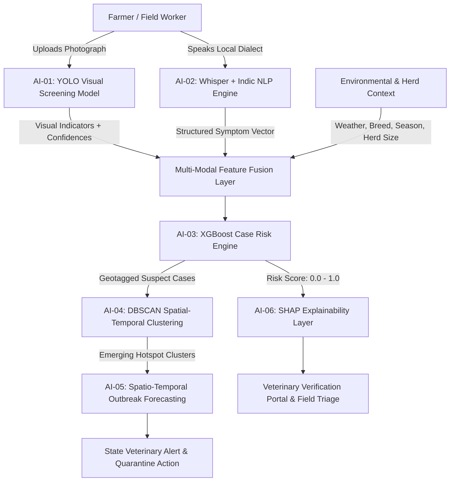

# FAUNA-X Multi-Modal AI Architecture & Downstream Integration

**Project**: FAUNA-X (Smart India Hackathon 2026 — Problem Statement: SIH26128)  
**Title**: Livestock Health Intelligence & Early Outbreak Response System

---

## 1. End-to-End System Architecture

FAUNA-X is engineered as a multi-stage, multi-modal veterinary intelligence pipeline designed to empower rural livestock farmers, field para-veterinarians, and state epidemiological authorities with early outbreak warnings.



---

## 2. Component Specifications

### AI-01: Visual Health Screening Model (Current Phase)
- **Role**: High-speed edge vision screening for cattle dermatological, oral, and mucosal visual patterns.
- **Model**: YOLO Fine-Tuned Backbone (`yolo11n-cls`).
- **Input**: RGB Field Photograph (smartphone camera / field capture).
- **Output**: Calibrated probability distribution across disease visual indicators and healthy controls.
- **Governing Rule**: *AI-assisted preliminary indicator detection only — never definitive veterinary diagnosis.*

### AI-02: Voice-to-Clinical Symptom NLP Pipeline
- **Role**: Transcribes farmer voice descriptions in regional Indian languages (Hindi, Marathi, Punjabi, Tamil, etc.) using fine-tuned Whisper and extracts standardized SNOMED-CT veterinary symptom entities (e.g., `fever`, `salivation`, `milk_drop`, `lameness`).

### AI-03: Multi-Modal XGBoost Case Risk Engine
- **Role**: Combines visual screening probabilities, extracted symptom vectors, herd vaccination history, and ambient weather covariates into an overall composite **Epidemiological Case Risk Score (0.0 to 1.0)**.

### AI-04: DBSCAN Spatial-Temporal Clustering
- **Role**: Analyzes geographical coordinates, reporting timestamps, and risk-weighted case logs using density-based spatial clustering of applications with noise (DBSCAN) with Haversine distance metrics to automatically detect disease outbreak clusters in real-time.

### AI-05: Spatio-Temporal Outbreak Forecasting
- **Role**: Forecasts 7-day and 14-day transmission trajectories across administrative blocks using vector-borne climate indices (temperature, humidity, precipitation, wind speed) and cattle movement density networks.

### AI-06: SHAP Clinical Explainability
- **Role**: Generates TreeSHAP feature importance plots to explain why a specific animal was flagged, providing field veterinary officers with full diagnostic transparency.

---

## 3. Data Contract: AI-01 Vision Output → AI-03 XGBoost Feature Fusion

Below is the formal, validated JSON schema emitted by the Vision screening engine (`predict.py --json`) that serves as the ingestion payload for downstream feature fusion:

```json
{
  "model": "faunax-livestock-vision",
  "version": "1.0.0",
  "animal_species": "cattle",
  "image_file": "case_10492_flank.jpg",
  "visual_indicators": [
    {
      "label": "cutaneous_nodules_and_lesions",
      "description": "Circumscribed cutaneous nodules, localized skin swelling, or ulcerated scabs",
      "confidence": 0.8924
    }
  ],
  "screening_result": {
    "class": "lumpy_skin",
    "display_name": "Lumpy Skin Disease (LSD)",
    "confidence": 0.8924,
    "status": "Potential visual indicator detected."
  },
  "all_probabilities": {
    "healthy": 0.0412,
    "lumpy_skin": 0.8924,
    "fmd": 0.0664
  },
  "requires_veterinary_verification": true,
  "clinical_disclaimer": "AI-assisted preliminary screening. This output is NOT a veterinary diagnosis."
}
```

### Feature Vector Mapping into XGBoost:
When the XGBoost model ingests this payload, it flattens the output into tabular features:
- `feat_vis_prob_lumpy_skin`: `0.8924`
- `feat_vis_prob_fmd`: `0.0664`
- `feat_vis_prob_healthy`: `0.0412`
- `feat_vis_top_confidence`: `0.8924`
- `feat_vis_indicator_flag`: `1` (Confidence > 0.65 threshold)

---
*Architectural Blueprint for SIH26128 — FAUNA-X Outbreak Response System.*
