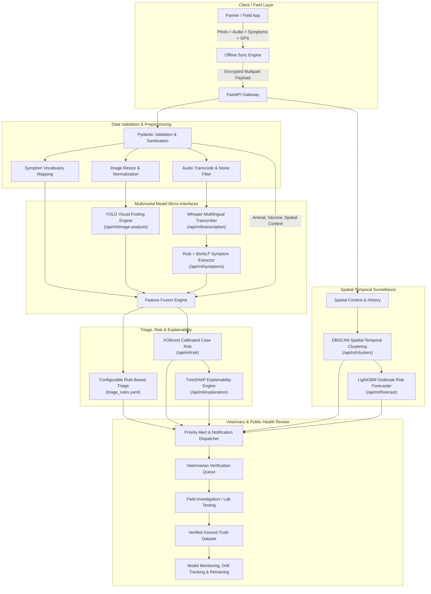

# FAUNA-X: System Architecture & Technical Specification

> **AI-Powered Livestock Health Intelligence & Early Outbreak Response System**  
> *A Multimodal Disease Surveillance, Spatial-Temporal Risk Forecasting & Decision-Support Platform*

---

## 1. Monorepo Folder Structure

```text
FaunaX/
├── backend/
│   ├── app/
│   │   ├── api/
│   │   │   ├── v1/
│   │   │   │   ├── auth.py
│   │   │   │   ├── users.py
│   │   │   │   ├── animals.py
│   │   │   │   ├── cases.py
│   │   │   │   ├── reports.py
│   │   │   │   ├── ml.py
│   │   │   │   ├── gis.py
│   │   │   │   ├── clusters.py
│   │   │   │   ├── forecasting.py
│   │   │   │   ├── veterinary.py
│   │   │   │   ├── laboratory.py
│   │   │   │   ├── vaccination.py
│   │   │   │   ├── alerts.py
│   │   │   │   ├── dashboard.py
│   │   │   │   ├── model_monitoring.py
│   │   │   │   └── admin.py
│   │   │   └── router.py
│   │   ├── core/
│   │   │   ├── config.py
│   │   │   ├── security.py
│   │   │   ├── database.py
│   │   │   ├── rbac.py
│   │   │   └── logging.py
│   │   ├── models/
│   │   │   ├── user.py
│   │   │   ├── animal.py
│   │   │   ├── case.py
│   │   │   ├── symptom.py
│   │   │   ├── media.py
│   │   │   ├── review.py
│   │   │   ├── lab.py
│   │   │   ├── vaccination.py
│   │   │   ├── alert.py
│   │   │   ├── cluster.py
│   │   │   ├── forecast.py
│   │   │   ├── model_registry.py
│   │   │   └── audit.py
│   │   ├── schemas/
│   │   │   ├── auth.py
│   │   │   ├── case.py
│   │   │   ├── ml.py
│   │   │   ├── gis.py
│   │   │   ├── vet.py
│   │   │   ├── lab.py
│   │   │   └── dashboard.py
│   │   ├── services/
│   │   │   ├── auth_service.py
│   │   │   ├── case_service.py
│   │   │   ├── ml_orchestrator.py
│   │   │   ├── gis_service.py
│   │   │   ├── cluster_service.py
│   │   │   ├── forecast_service.py
│   │   │   ├── alert_service.py
│   │   │   ├── lab_service.py
│   │   │   └── sync_service.py
│   │   └── main.py
│   └── tests/
├── ml/
│   ├── datasets/
│   │   ├── metadata.json
│   │   └── symptoms.json
│   ├── image/
│   │   ├── model.py
│   │   ├── preprocess.py
│   │   ├── postprocess.py
│   │   ├── inference.py
│   │   └── train.py
│   ├── speech/
│   │   ├── audio_processing.py
│   │   ├── language.py
│   │   └── transcription.py
│   ├── nlp/
│   │   ├── symptom_extraction.py
│   │   ├── vocabulary.py
│   │   └── train.py
│   ├── rules/
│   │   ├── triage_rules.yaml
│   │   └── rule_engine.py
│   ├── risk/
│   │   ├── feature_engineering.py
│   │   ├── train_xgboost.py
│   │   ├── evaluate_xgboost.py
│   │   ├── calibrate.py
│   │   └── inference.py
│   ├── clustering/
│   │   ├── dbscan.py
│   │   └── cluster_analyzer.py
│   ├── forecasting/
│   │   ├── time_series_features.py
│   │   ├── train_lightgbm.py
│   │   └── forecast_engine.py
│   ├── explainability/
│   │   └── shap_explainer.py
│   └── common/
│       ├── base_model.py
│       ├── schemas.py
│       └── registry.py
├── frontend/
│   ├── src/
│   │   ├── components/
│   │   │   ├── common/
│   │   │   │   ├── Header.tsx
│   │   │   │   ├── Sidebar.tsx
│   │   │   │   ├── StatusBadge.tsx
│   │   │   │   ├── ModelValidationBanner.tsx
│   │   │   │   └── OfflineSyncIndicator.tsx
│   │   │   ├── farmer/
│   │   │   │   ├── ReportWizardSteps.tsx
│   │   │   │   ├── PhotoUploader.tsx
│   │   │   │   ├── VoiceRecorder.tsx
│   │   │   │   └── SymptomSelector.tsx
│   │   │   ├── vet/
│   │   │   │   ├── CaseReviewModal.tsx
│   │   │   │   ├── ShapWaterfallChart.tsx
│   │   │   │   ├── LabReferralForm.tsx
│   │   │   │   └── TreatmentPlanForm.tsx
│   │   │   ├── gis/
│   │   │   │   ├── DiseaseMap.tsx
│   │   │   │   ├── ClusterLayer.tsx
│   │   │   │   └── HeatmapLayer.tsx
│   │   │   └── analytics/
│   │   │       ├── TrendChart.tsx
│   │   │       ├── RiskDistributionPie.tsx
│   │   │       └── ModelDriftChart.tsx
│   │   ├── pages/
│   │   │   ├── LandingPage.tsx
│   │   │   ├── LoginPage.tsx
│   │   │   ├── FarmerDashboard.tsx
│   │   │   ├── FarmerReportWizard.tsx
│   │   │   ├── MyAnimalsPage.tsx
│   │   │   ├── VetDashboard.tsx
│   │   │   ├── VetCaseReview.tsx
│   │   │   ├── FieldOfficerDashboard.tsx
│   │   │   ├── GISMapPage.tsx
│   │   │   ├── OutbreakForecastPage.tsx
│   │   │   ├── LaboratoryPage.tsx
│   │   │   ├── VaccinationPage.tsx
│   │   │   ├── DistrictDashboard.tsx
│   │   │   ├── StateNationalDashboard.tsx
│   │   │   ├── ModelMonitoringPage.tsx
│   │   │   └── AdminPanel.tsx
│   │   ├── context/
│   │   │   ├── AuthContext.tsx
│   │   │   └── OfflineSyncContext.tsx
│   │   └── services/
│   │       ├── api.ts
│   │       ├── offlineDb.ts
│   │       └── syncWorker.ts
│   └── package.json
└── docker/
    ├── docker-compose.yml
    ├── Dockerfile.backend
    └── Dockerfile.frontend
```

---

## 2. Database Schema (PostgreSQL + PostGIS)

```sql
-- Enums
CREATE TYPE user_role AS ENUM ('FARMER', 'VETERINARIAN', 'FIELD_OFFICER', 'DISTRICT_ADMIN', 'STATE_ADMIN', 'NATIONAL_ADMIN');
CREATE TYPE risk_level AS ENUM ('LOW', 'MEDIUM', 'HIGH', 'CRITICAL');
CREATE TYPE case_status AS ENUM ('PENDING_REVIEW', 'UNDER_INVESTIGATION', 'VERIFIED', 'REJECTED', 'CLOSED');
CREATE TYPE lab_status AS ENUM ('SAMPLE_COLLECTED', 'IN_TRANSIT', 'PROCESSING', 'CONFIRMED_POSITIVE', 'CONFIRMED_NEGATIVE', 'INCONCLUSIVE');
CREATE TYPE sync_status AS ENUM ('PENDING', 'UPLOADING', 'SYNCED', 'FAILED');

-- Core Tables
CREATE TABLE users (
    id UUID PRIMARY KEY DEFAULT gen_random_uuid(),
    email VARCHAR(255) UNIQUE NOT NULL,
    hashed_password VARCHAR(255) NOT NULL,
    full_name VARCHAR(255) NOT NULL,
    phone_number VARCHAR(32),
    role user_role NOT NULL DEFAULT 'FARMER',
    state VARCHAR(100),
    district VARCHAR(100),
    sub_district VARCHAR(100),
    village VARCHAR(100),
    is_active BOOLEAN DEFAULT TRUE,
    created_at TIMESTAMP WITH TIME ZONE DEFAULT NOW()
);

CREATE TABLE animals (
    id UUID PRIMARY KEY DEFAULT gen_random_uuid(),
    owner_id UUID REFERENCES users(id) ON DELETE CASCADE,
    tag_id VARCHAR(64) UNIQUE,
    species VARCHAR(64) NOT NULL, -- Cattle, Buffalo, Sheep, Goat, Swine, Poultry
    breed VARCHAR(128),
    age_months INT,
    gender VARCHAR(16),
    herd_size INT DEFAULT 1,
    vaccination_history JSONB DEFAULT '[]'::jsonb,
    created_at TIMESTAMP WITH TIME ZONE DEFAULT NOW()
);

CREATE TABLE cases (
    id UUID PRIMARY KEY DEFAULT gen_random_uuid(),
    case_number VARCHAR(32) UNIQUE NOT NULL,
    reporter_id UUID REFERENCES users(id),
    animal_id UUID REFERENCES animals(id),
    species VARCHAR(64) NOT NULL,
    affected_count INT DEFAULT 1,
    location_geom GEOMETRY(Point, 4326),
    latitude NUMERIC(10, 7) NOT NULL,
    longitude NUMERIC(10, 7) NOT NULL,
    address_masked VARCHAR(255), -- Privacy-safe public reference
    temperature_c NUMERIC(4, 1),
    appetite_status VARCHAR(32),
    mobility_status VARCHAR(32),
    duration_days INT,
    status case_status DEFAULT 'PENDING_REVIEW',
    ai_risk_score NUMERIC(4, 3),
    ai_risk_level risk_level DEFAULT 'LOW',
    ai_confidence NUMERIC(4, 3),
    ai_validation_status VARCHAR(64) DEFAULT 'PROTOTYPE_NOT_CLINICALLY_VALIDATED',
    rule_triage_priority VARCHAR(32) DEFAULT 'ROUTINE',
    offline_sync_status sync_status DEFAULT 'SYNCED',
    created_at TIMESTAMP WITH TIME ZONE DEFAULT NOW(),
    updated_at TIMESTAMP WITH TIME ZONE DEFAULT NOW()
);

CREATE TABLE case_symptoms (
    id UUID PRIMARY KEY DEFAULT gen_random_uuid(),
    case_id UUID REFERENCES cases(id) ON DELETE CASCADE,
    symptom_key VARCHAR(64) NOT NULL,
    severity VARCHAR(32),
    source VARCHAR(32) -- 'FARMER_SELECTED', 'VOICE_NLP_EXTRACTED', 'VET_CONFIRMED'
);

CREATE TABLE case_images (
    id UUID PRIMARY KEY DEFAULT gen_random_uuid(),
    case_id UUID REFERENCES cases(id) ON DELETE CASCADE,
    image_url VARCHAR(512) NOT NULL,
    visual_findings JSONB DEFAULT '[]'::jsonb, -- Bounding boxes, lesions, skin nodules
    yolo_model_version VARCHAR(64),
    yolo_confidence NUMERIC(4, 3),
    created_at TIMESTAMP WITH TIME ZONE DEFAULT NOW()
);

CREATE TABLE voice_reports (
    id UUID PRIMARY KEY DEFAULT gen_random_uuid(),
    case_id UUID REFERENCES cases(id) ON DELETE CASCADE,
    audio_url VARCHAR(512) NOT NULL,
    transcript TEXT,
    detected_language VARCHAR(32),
    whisper_model_version VARCHAR(64),
    extracted_symptoms JSONB DEFAULT '{}'::jsonb,
    created_at TIMESTAMP WITH TIME ZONE DEFAULT NOW()
);

CREATE TABLE case_ai_explanations (
    id UUID PRIMARY KEY DEFAULT gen_random_uuid(),
    case_id UUID REFERENCES cases(id) ON DELETE CASCADE,
    feature_vector JSONB NOT NULL,
    shap_base_value NUMERIC(6, 4),
    shap_contributions JSONB NOT NULL, -- Key-value pairs of feature impact
    top_positive_factors JSONB DEFAULT '[]'::jsonb,
    top_negative_factors JSONB DEFAULT '[]'::jsonb,
    model_version VARCHAR(64) NOT NULL,
    created_at TIMESTAMP WITH TIME ZONE DEFAULT NOW()
);

CREATE TABLE veterinarian_reviews (
    id UUID PRIMARY KEY DEFAULT gen_random_uuid(),
    case_id UUID REFERENCES cases(id) ON DELETE CASCADE,
    veterinarian_id UUID REFERENCES users(id),
    verification_status case_status NOT NULL, -- VERIFIED, REJECTED, etc.
    preliminary_diagnosis VARCHAR(255),
    clinical_notes TEXT,
    differential_diagnoses JSONB DEFAULT '[]'::jsonb,
    sample_collection_ordered BOOLEAN DEFAULT FALSE,
    treatment_prescribed TEXT,
    isolation_recommended BOOLEAN DEFAULT FALSE,
    review_timestamp TIMESTAMP WITH TIME ZONE DEFAULT NOW()
);

CREATE TABLE lab_records (
    id UUID PRIMARY KEY DEFAULT gen_random_uuid(),
    case_id UUID REFERENCES cases(id) ON DELETE CASCADE,
    sample_type VARCHAR(64) NOT NULL,
    collection_date DATE NOT NULL,
    lab_name VARCHAR(255) NOT NULL,
    test_method VARCHAR(128) NOT NULL, -- PCR, ELISA, Microscopy
    result lab_status DEFAULT 'PROCESSING',
    confirmed_pathogen VARCHAR(255),
    report_url VARCHAR(512),
    result_date TIMESTAMP WITH TIME ZONE
);

CREATE TABLE disease_clusters (
    id UUID PRIMARY KEY DEFAULT gen_random_uuid(),
    cluster_code VARCHAR(64) UNIQUE NOT NULL,
    centroid_geom GEOMETRY(Point, 4326),
    latitude NUMERIC(10, 7) NOT NULL,
    longitude NUMERIC(10, 7) NOT NULL,
    radius_km NUMERIC(6, 2) NOT NULL,
    case_count INT NOT NULL,
    primary_species VARCHAR(64),
    risk_level risk_level DEFAULT 'MEDIUM',
    dbscan_eps NUMERIC(6, 3),
    dbscan_min_samples INT,
    status VARCHAR(32) DEFAULT 'ACTIVE',
    first_case_time TIMESTAMP WITH TIME ZONE,
    latest_case_time TIMESTAMP WITH TIME ZONE,
    created_at TIMESTAMP WITH TIME ZONE DEFAULT NOW()
);

CREATE TABLE outbreak_forecasts (
    id UUID PRIMARY KEY DEFAULT gen_random_uuid(),
    region_type VARCHAR(32) NOT NULL, -- 'DISTRICT', 'STATE'
    region_name VARCHAR(128) NOT NULL,
    forecast_horizon_days INT NOT NULL, -- 7, 14, 30
    predicted_risk_level risk_level NOT NULL,
    risk_trend VARCHAR(32) NOT NULL, -- 'INCREASING', 'STABLE', 'DECREASING'
    predicted_cases_mean NUMERIC(8, 2),
    growth_rate NUMERIC(6, 3),
    confidence_interval JSONB,
    model_version VARCHAR(64) NOT NULL,
    created_at TIMESTAMP WITH TIME ZONE DEFAULT NOW()
);

CREATE TABLE alerts (
    id UUID PRIMARY KEY DEFAULT gen_random_uuid(),
    title VARCHAR(255) NOT NULL,
    message TEXT NOT NULL,
    priority risk_level NOT NULL,
    target_role user_role,
    district VARCHAR(100),
    state VARCHAR(100),
    related_case_id UUID REFERENCES cases(id),
    related_cluster_id UUID REFERENCES disease_clusters(id),
    is_broadcast BOOLEAN DEFAULT FALSE,
    created_at TIMESTAMP WITH TIME ZONE DEFAULT NOW()
);

CREATE TABLE model_registry (
    id UUID PRIMARY KEY DEFAULT gen_random_uuid(),
    model_name VARCHAR(128) NOT NULL,
    model_task VARCHAR(64) NOT NULL, -- 'VISION_YOLO', 'SPEECH_WHISPER', 'RISK_XGBOOST', 'CLUSTERING_DBSCAN', 'FORECAST_LIGHTGBM'
    version VARCHAR(32) NOT NULL,
    status VARCHAR(32) NOT NULL, -- 'PROTOTYPE', 'VALIDATED', 'DEPRECATED'
    training_dataset_id VARCHAR(128),
    metrics JSONB DEFAULT '{}'::jsonb, -- precision, recall, f1, auc, fpr, fnr
    feature_schema_version VARCHAR(32),
    created_at TIMESTAMP WITH TIME ZONE DEFAULT NOW()
);

CREATE TABLE audit_logs (
    id UUID PRIMARY KEY DEFAULT gen_random_uuid(),
    user_id UUID,
    action VARCHAR(128) NOT NULL,
    resource_type VARCHAR(64) NOT NULL,
    resource_id UUID,
    details JSONB,
    ip_address VARCHAR(45),
    created_at TIMESTAMP WITH TIME ZONE DEFAULT NOW()
);

-- Spatial and Performance Indexes
CREATE INDEX idx_cases_location ON cases USING GIST (location_geom);
CREATE INDEX idx_cases_status_risk ON cases (status, ai_risk_level);
CREATE INDEX idx_cases_created_at ON cases (created_at DESC);
CREATE INDEX idx_clusters_geom ON disease_clusters USING GIST (centroid_geom);
CREATE INDEX idx_alerts_priority ON alerts (priority, created_at DESC);
```

---

## 3. Pluggable ML Pipeline Architecture & Model Interfaces



### Standardized Model Interface Contracts

All model services inherit from `BaseMLService` with explicit `ModelValidationStatus`:

```python
from abc import ABC, abstractmethod
from typing import Generic, TypeVar
from pydantic import BaseModel
from enum import Enum

class ModelValidationStatus(str, Enum):
    PROTOTYPE = "PROTOTYPE_NOT_CLINICALLY_VALIDATED"
    EXPERIMENTAL = "EXPERIMENTAL_PILOT"
    VALIDATED = "CLINICALLY_BENCHMARKED_VALIDATED"

class MLResponseMetadata(BaseModel):
    model_name: str
    model_version: str
    validation_status: ModelValidationStatus
    inference_time_ms: float
    disclaimer: str = "AI provides risk estimation and indicator extraction only. Clinical verification remains with licensed veterinarians."

T_Input = TypeVar("T_Input")
T_Output = TypeVar("T_Output")

class BaseMLService(ABC, Generic[T_Input, T_Output]):
    @abstractmethod
    def predict(self, input_data: T_Input) -> T_Output:
        pass
    
    @abstractmethod
    def get_metadata(self) -> MLResponseMetadata:
        pass
```

---

## 4. Phase-by-Phase Implementation Execution Plan

1. **Phase 1: Project Foundations & Monorepo Configuration**  
   - Configure PostgreSQL/PostGIS database schemas, migrations, seed synthetic datasets.
   - Setup JWT RBAC authentication with 6 distinct roles (Farmer, Vet, Field Officer, District Admin, State Admin, National Admin).

2. **Phase 2: Offline-First Farmer Reporting Module**  
   - 6-step guided reporting wizard with image upload, voice capture, multi-symptom selector, geolocation capture, IndexedDB offline persistence & auto-sync queue.

3. **Phase 3: Multimodal ML Core Modules**  
   - **YOLO Visual Detector**: lesion/nodule detection with bounding box coordinates and confidence.
   - **Whisper & NLP**: Multilingual audio transcription with dictionary-backed symptom token matching (`symptoms.json`).
   - **Feature Fusion & Rule Triage**: Normalization, missing value imputation, `triage_rules.yaml` priority scoring.
   - **XGBoost Risk Scorer**: Probability calibrated scoring with SHAP waterfall explanations.

4. **Phase 4: Spatial-Temporal Surveillance & Forecasting**  
   - **DBSCAN Clustering**: Spatio-temporal cluster detection (haversine distance + time decay).
   - **LightGBM Outbreak Forecaster**: 7/14/30-day district risk trajectories.
   - **GIS Disease Map**: Interactive PostGIS vector tile map with cluster boundaries, privacy masking, and layer toggles.

5. **Phase 5: Decision Support, Lab, Vaccination & Role Dashboards**  
   - **Veterinarian Review Hub**: 3-panel review (Patient + AI findings + GIS context + verified outcome submission).
   - **Laboratory & Vaccination Portals**: Sample collection lifecycle tracking and immunization heatmaps.
   - **Multi-Tier Dashboards**: District, State, and National epidemiological command centers.
   - **Model Monitoring & SIH Demonstration Mode**: Drift monitoring metrics and synthetic scenario runner.
